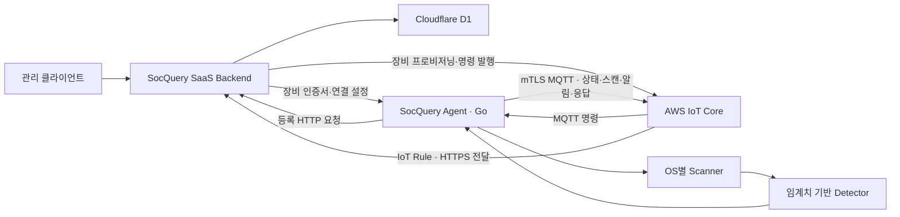

# SocQuery Agent

Go로 개발한 장비 모니터링·원격 관리 프로그램입니다. USB·시스템 자원·프로세스·네트워크 상태를 수집하고, 이상 알림과 원격 점검 결과를 MQTT로 전송합니다.

**백승규([decembaek](https://github.com/decembaek)) · 개인 프로젝트 · 단독 설계·개발**

장비 등록과 데이터·명령 이력을 관리하는 [SocQuery SaaS Backend](https://github.com/decembaek/socquery-saas-backend)도 함께 개발했습니다.
현재 개발·로컬 검증 단계로, 키오스크 현장 설치 전입니다.

## 개발 배경

지인에게서 키오스크와 카드 단말기가 자주 고장 난다는 이야기를 듣고 만들기 시작했습니다. 문제가 생겼을 때 USB 연결 상태와 PC의 자원·프로세스·네트워크 상태를 원격에서 확인하고, 점검한 결과를 남길 수 있도록 개발했습니다.

## 개발한 내용

장비 등록, 주기적인 상태 수집, 이상·복구 알림, 원격 명령 실행을 구현했습니다.
USB 장치가 연결되거나 분리되면 이벤트를 만들고, CPU·메모리의 임계치 초과가 이어지면 알림을 발행합니다.
원격 명령에는 같은 명령 ID로 결과·오류·소요 시간을 반환해 서버에서 요청과 실행 결과를 대조할 수 있게 했습니다.


## 전체 시스템 구조



AWS IoT 정책·Rule과 관리 API는 별도로 구성해야 합니다.

## 구현한 기능

| 기능 | 구현 내용 | 주요 코드 |
| --- | --- | --- |
| 장비 등록 | 등록 토큰과 머신 ID를 관리 API에 전달하고 장비별 연결 설정 수신 | [config/load_set.go](internal/config/load_set.go) |
| 인증 설정 보관 | 머신 ID 기반 키 파생과 AES-256-GCM으로 로컬 설정 암호화 | [config/crypto.go](internal/config/crypto.go) |
| MQTT 연결 | 장비 인증서·개인키 기반 mTLS, QoS 1, 자동 재연결 옵션 | [protocol/aws_mqtt_client.go](internal/protocol/aws_mqtt_client.go) |
| 시스템 상태 | CPU·메모리·디스크·OS 정보 수집 | [scanner/health.go](internal/scanner/health.go) |
| 프로세스와 네트워크 | CPU·메모리 상위 프로세스, 인터페이스·연결 통계·DNS 조회 상태 | [scanner](internal/scanner) |
| USB 상태 | 장치 목록과 연결·분리 변경 감지 | [scanner/usb.go](internal/scanner/usb.go), [anomaly/usb.go](internal/anomaly/usb.go) |
| 이상 알림 | 임계치·연속 횟수·복구 조건과 알림 반복 간격 적용 | [anomaly](internal/anomaly) |
| 원격 점검 | ping, 스캔 요청, HTTP 요청의 명령 분기와 응답 발행 | [executor/router.go](internal/executor/router.go) |
| 종료 처리 | 종료 시그널을 받아 주기 수집 중단 요청, offline 상태 발행 시도와 연결 종료 | [cmd/agent/main.go](cmd/agent/main.go) |

## 핵심 설계

### 주기별 수집 작업

USB는 15초, 시스템 상태는 30초, 프로세스와 네트워크는 각각 60초 주기로 수집하도록 구성했습니다. 각 작업은 별도 ticker와 goroutine을 사용해 서로 다른 주기로 동작합니다.

Scanner에서 OS별 정보를 수집하고 Detector에서 임계치와 상태 변화를 판단합니다. `main.go`는 각 수집 작업을 실행하고 결과를 MQTT로 발행합니다.

### 원격 명령 실행

명령은 `commandId`, `action`, `params`, `timeout`을 담습니다. 실행 결과는 같은 `commandId`와 함께 종료 코드, 실행 시각, 소요 시간, 데이터 또는 오류를 반환합니다.

명령을 별도 goroutine으로 처리하고 context에 실행 제한 시간을 설정합니다. HTTP 요청은 해당 context를 사용하며 응답 본문은 최대 1 MiB까지 보관합니다.

### 이상·복구 알림

CPU·메모리는 임계치를 넘은 연속 횟수를 추적하고, 디스크는 임계치에 따라 판단합니다. 복구 상태를 별도 알림으로 만들고, 같은 심각도의 알림은 반복 간격을 두어 발행합니다.

USB 감지기는 최초 목록을 기준으로 이후 장치의 추가·제거를 비교합니다. 임계치와 감시 대상은 현재 코드의 설정 구조체에서 관리합니다.

### OS별 수집기

Go build tag로 Linux·macOS·Windows 구현을 선택하고 공통 구조체로 결과를 반환합니다.

| 환경 | 사용하는 정보원과 명령 |
| --- | --- |
| Linux | `/proc`, `/sys`, `ps`, `netstat`, 파일시스템 통계 |
| macOS | `top`, `sysctl`, `vm_stat`, `ioreg`, `ps`, `netstat` |
| Windows | PowerShell, `netstat`, Windows 시스템 API |

일부 수집기는 OS 명령 출력에 의존합니다. 실행 환경의 권한·명령 설치 여부와 출력 형식에 따라 결과가 달라질 수 있습니다.

## 기술과 디렉터리

- Go: `go.mod` 기준 1.25.6
- MQTT: Eclipse Paho MQTT Go
- 머신 식별: `denisbrodbeck/machineid`
- 통신과 암호화: Go 표준 라이브러리의 HTTP, TLS, AES-GCM
- 연결 대상: AWS IoT Core, SocQuery 관리 API

```text
cmd/agent/main.go        CLI, 초기화, 수집 주기와 MQTT 연결
internal/
  config/               등록, 머신 ID, 인증 설정 저장
  scanner/              OS별 상태·프로세스·네트워크·USB 수집
  anomaly/              리소스·프로세스·네트워크·USB 감지기
  protocol/             AWS IoT MQTT 클라이언트
  executor/             명령 파싱·분기·HTTP 요청·결과 생성
build.sh                Windows·Linux·macOS 빌드 명령
.github/workflows/      태그 기반 바이너리 빌드·릴리스 구성
docs/BINARY_HOSTING.md   별도 바이너리 호스팅 구성 참고
```

## 빠른 시작

### 로컬 상태 수집 확인

Go 1.25.6 이상을 준비합니다. 먼저 클라우드 등록이 필요 없는 1회 상태 수집으로 실행 흐름을 확인할 수 있습니다.

```bash
git clone https://github.com/decembaek/socquery-agent-go.git
cd socquery-agent-go
go mod download
go build -o build/soc ./cmd/agent
./build/soc --help
./build/soc --scan-health
```

`--scan-health`는 현재 장비의 CPU·메모리·디스크·OS 정보를 출력한 뒤 종료합니다. AWS 인증서나 장비 등록 토큰을 사용하지 않습니다.

| 플래그 | 동작 |
| --- | --- |
| `--scan-health` | 시스템 자원과 OS 정보 1회 수집 |
| `--scan-process` | 프로세스 수집 |
| `--scan-usb` | USB 장치 수집 |
| `--scan-network` | 인터페이스·연결 통계 수집과 DNS 조회 |
| `--scan-all` | 모든 수집기를 차례로 실행 |
| `--detect-test` | 1회 수집 결과를 감지기에 공급해 출력 |

네트워크 수집은 `dns.google` 조회를 수행합니다. `--detect-test` 한 번으로는 여러 번 연속 발생해야 하는 알림 조건 전체를 검증할 수 없습니다.

### 관리 API와 연결

[백엔드 실행 안내](https://github.com/decembaek/socquery-saas-backend#로컬-빠른-시작)에 따라 관리 API와 AWS IoT 설정을 준비하고 장비 등록 토큰을 발급합니다.

```bash
SOC_REGISTER_URL="http://localhost:8787/api/v1/agents/register" \
  ./build/soc --token "<REGISTRATION_TOKEN>"
```

1. 머신 ID와 등록 토큰으로 관리 API에 등록을 요청합니다.
2. 장비 이름, 소속 계정, 인증서·개인키와 IoT 엔드포인트를 받습니다.
3. 인증 설정을 OS 사용자 설정 디렉터리의 `socquery-agent/auth.enc`에 저장합니다.
4. MQTT에 연결해 명령 토픽을 구독하고 주기적인 상태 수집을 시작합니다.

`SOC_REGISTER_URL`을 생략하면 코드에 지정된 기본 등록 주소를 사용합니다. 로컬 환경에서는 위와 같이 연결할 API 주소를 직접 지정합니다. 이후 실행은 저장한 설정을 사용하므로 `./build/soc`만 실행합니다.

`--reset`은 저장한 인증 설정을 삭제합니다. 다른 서버나 계정으로 다시 등록할 때 사용하며, 삭제 후에는 새 등록 토큰이 필요합니다.

### OS별 빌드

```bash
# Linux amd64
GOOS=linux GOARCH=amd64 CGO_ENABLED=0 go build -o build/soc-linux ./cmd/agent

# macOS Apple Silicon
GOOS=darwin GOARCH=arm64 CGO_ENABLED=0 go build -o build/soc-darwin-arm64 ./cmd/agent

# Windows amd64
GOOS=windows GOARCH=amd64 CGO_ENABLED=0 go build -o build/soc.exe ./cmd/agent
```

실행은 각 대상 OS에서 확인해야 합니다. 저장소의 `build.sh`와 태그 기반 릴리스 워크플로우도 참고할 수 있습니다. 릴리스 바이너리의 제공 여부와 파일명은 [Releases](https://github.com/decembaek/socquery-agent-go/releases)에서 확인합니다.

## MQTT 메시지 흐름

토픽 접두어는 `socquery/{tenant_id}/{thingName}`입니다. 아래 경로는 그 뒤에 붙는 실제 에이전트 토픽입니다.

| 방향 | 토픽 경로 | 용도 |
| --- | --- | --- |
| 발행 | `/agent/status` | online·offline 상태 |
| 발행 | `/system/health` | CPU·메모리·디스크·OS 정보 |
| 발행 | `/scan/usb` | USB 목록 |
| 발행 | `/scan/process` | 프로세스 정보 |
| 발행 | `/scan/network` | 네트워크 정보 |
| 발행 | `/anomaly/alert` | 감지 알림 |
| 구독 | `/agent/command` | 원격 점검 명령 |
| 발행 | `/agent/response` | 명령 실행 결과 |

명령 메시지 예시는 다음과 같습니다.

```json
{
  "commandId": "demo-ping-001",
  "action": "ping",
  "params": {},
  "timeout": 30
}
```

지원 action은 `ping`, `scan_health`, `scan_usb`, `scan_process`, `scan_network`, `scan_all`, `http_request`입니다. MQTT 상태·스캔 메시지를 관리 API에 전달하려면 위 토픽과 맞는 IoT Rule과 웹훅 전달 형식이 필요합니다.

## 로컬 검증

2026-11-05에 Go 1.25.6으로 확인한 결과입니다.

| 확인 항목 | 결과와 범위 |
| --- | --- |
| 빌드·정적 검사 | `go build ./...`, `go vet ./...` 통과 |
| 테스트 명령 | `go test ./...` 정상 종료. 모든 패키지가 `no test files`이며 자동 테스트는 아직 없음 |
| 크로스 빌드 | Linux amd64·arm64, macOS amd64·arm64, Windows amd64의 5개 대상에서 `CGO_ENABLED=0` 빌드 5/5 통과 |
| CLI 실행 | macOS arm64에서 `--help`, `--scan-health` 정상 종료 |
| 추가 실행 검증 | 다른 OS의 실제 실행과 AWS 장비 등록·MQTT 연동은 확인 전 |

동일한 소스 검사는 다음 명령으로 실행합니다.

```bash
go build ./...
go vet ./...
go test ./...
```

## 알려진 제약과 다음 작업

USB 수집은 장치 인식과 연결 변화를 확인하는 기능입니다. 카드 결제 승인 진단·단말기 전용 프로토콜·고장 자동 복구는 구현하지 않았습니다. 현장 설치에 따른 고장·출동·점검 시간 감소도 측정하지 않았습니다.

이상 감지는 리소스 임계치와 상태 변화에 기반하며 모델 학습이나 LLM 추론을 사용하지 않습니다. 인증 설정은 머신 ID에서 파생한 키로 로컬 파일에 보관합니다. OS 보안 저장소 연동은 보완 과제입니다.

- MQTT 단절 후 명령 재구독·복구 확인과, 연결 끊김 이벤트를 감지기에 전달하는 연결
- 등록 요청·OS 명령의 시간 제한, 취소 전파와 종료 시 실행 중 작업을 기다리는 처리
- 원격 명령의 동시 실행 수 제한, HTTP 요청 대상과 권한 관리
- OS별 지표 의미와 수집 실패 처리의 일관성, 전체 프로세스 기반 감시 대상 확인
- 등록·알림·명령 응답의 재현 가능한 통합 테스트와 지속적인 빌드 확인
- `go.mod`와 릴리스 워크플로우의 Go 버전 정합성, 비어 있는 서비스·컨테이너 배포 파일 보완

## 관련 저장소와 작성자

- [SocQuery SaaS Backend](https://github.com/decembaek/socquery-saas-backend): 계정·장비·명령·이벤트 관리
- [백승규 GitHub](https://github.com/decembaek)
- [포트폴리오](https://decembaek.com/)

현재 별도의 `LICENSE` 파일은 제공하지 않습니다.
